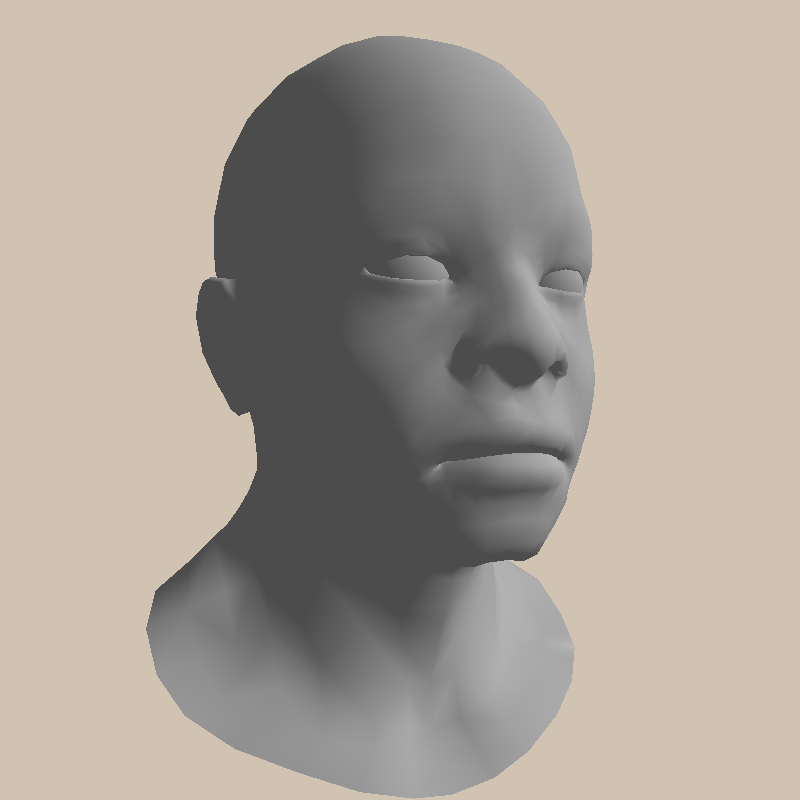
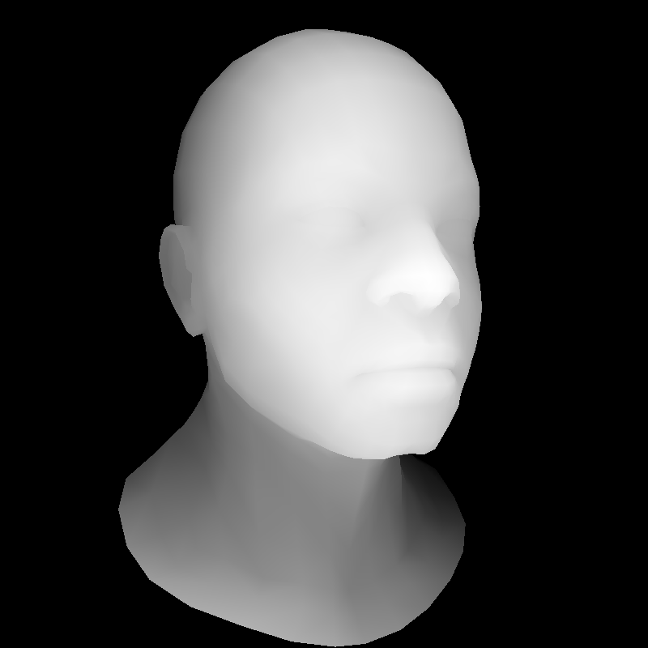

# Software Rasterizer in C++

A CPU software rasterizer written in C++ with no external graphics libraries, built by following the [Tiny Renderer](https://haqr.eu/tinyrenderer/) course by Dmitry V. Sokolov.




## Features

- **Mesh Processing & OBJ Loader**: Parses OBJ models with vertices, normals, and triangulated faces.
- **Linear Algebra Library**: Custom vector and matrix math classes supporting arbitrary dimensions, matrix multiplication, determinants, and matrix transposition/inversion.
- **Transformation Pipeline**: Complete camera look-at positioning (`ModelView`), perspective projection (`Perspective`), and viewport mapping (`Viewport`).
- **Triangle Rasterization**: Barycentric coordinate evaluation with bounding-box clipping and backface culling.
- **Z-Buffering**: Per-pixel depth interpolation and depth testing for accurate hidden-surface removal.
- **Shading & Lighting**:
  - Programmable shader interface (`IShader`).
  - Flat and smooth normal interpolation.
  - Full Phong reflection model combining ambient, diffuse, and specular light components.
- **Performance**: Multi-threaded pixel rasterization powered by OpenMP.
- **Output Visualization**: Color framebuffer and normalized grayscale depth buffer exported as TGA images.

## Build and Run

Requires CMake and a C++20 compiler with OpenMP support.

```bash
cmake -B build
cmake --build build -j
./build/tinyrenderer path/to/model.obj
```

The rendered image is saved to `framebuffer.tga` and the visualized depth buffer is written to `zbuffer.tga`.
The loader expects triangulated OBJ files. Models are not included in this repository.

## Credits

This project follows the Tiny Renderer course, "Software rendering in 500 lines of bare C++", by Dmitry V. Sokolov: <https://haqr.eu/tinyrenderer/>.

The starting code comes from the course's [repository](https://github.com/ssloy/tinyrenderer): the TGA image class (`tgaimage.h`, `tgaimage.cpp`) and the CMake build configuration. It is included under the course's permissive license, whose notice is kept in `LICENSE-tinyrenderer.txt`.