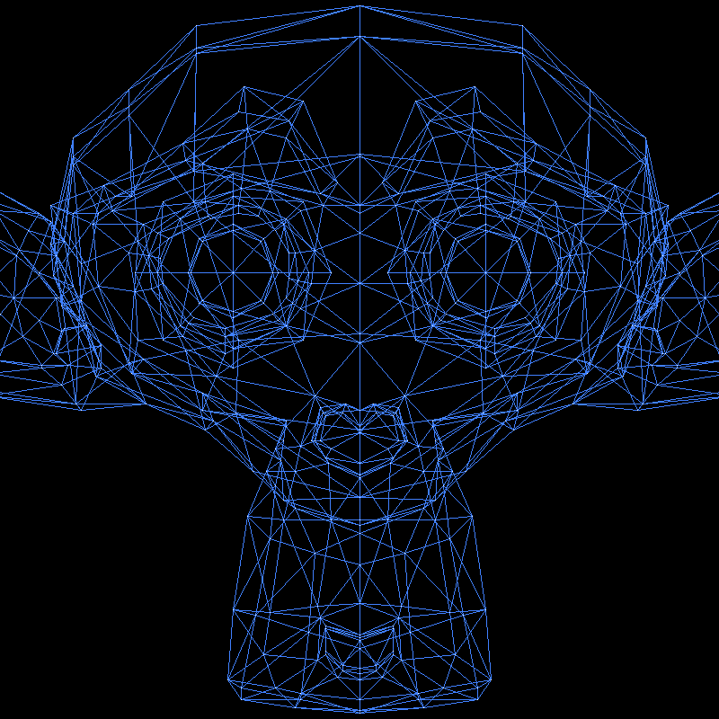

# Software Rasterizer in C++

A CPU software rasterizer written in C++ with no graphics library, built by following the [Tiny Renderer](https://haqr.eu/tinyrenderer/) course by Dmitry V. Sokolov. Work in progress.



## Features

- Line drawing with Bresenham's algorithm
- OBJ model loading (vertices and triangulated faces)
- Orthographic projection
- Wireframe rendering: every face's edges, plus a point at each vertex
- TGA image output

## Build and run

Requires CMake and a C++20 compiler.

```bash
cmake -Bbuild
cmake --build build -j
build/tinyrenderer path/to/model.obj
```

The render is written to `framebuffer.tga`. The loader expects triangulated OBJ files. Models are not included in this repository.

## Credits

This project follows the Tiny Renderer course, "Software rendering in 500 lines of bare C++", by Dmitry V. Sokolov: <https://haqr.eu/tinyrenderer/>.

The starting code comes from the course's [repository](https://github.com/ssloy/tinyrenderer): the TGA image class (`tgaimage.h`, `tgaimage.cpp`) and the CMake file. It is included under the course's permissive license, whose notice is kept in `LICENSE-tinyrenderer.txt`. The rest of the code, including the line drawing, the OBJ loader, the projection and the wireframe rendering, I wrote myself while following the course's articles.

Model: Suzanne, the Blender mascot, by Willem-Paul van Overbruggen for [Blender](https://www.blender.org/).